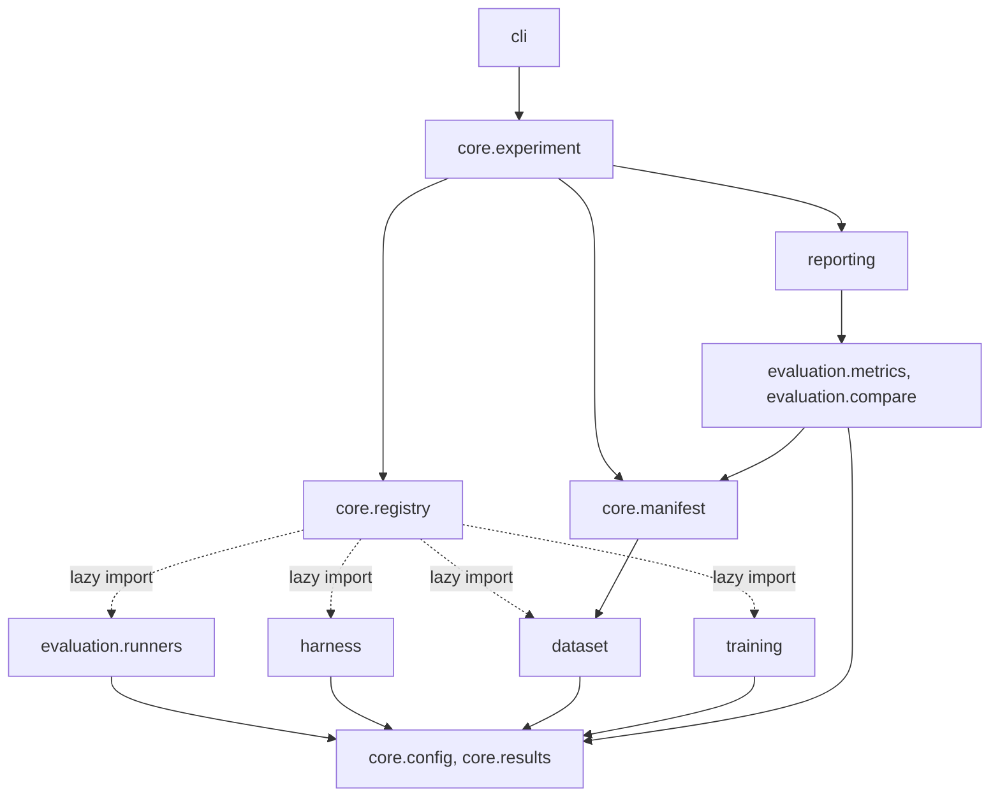
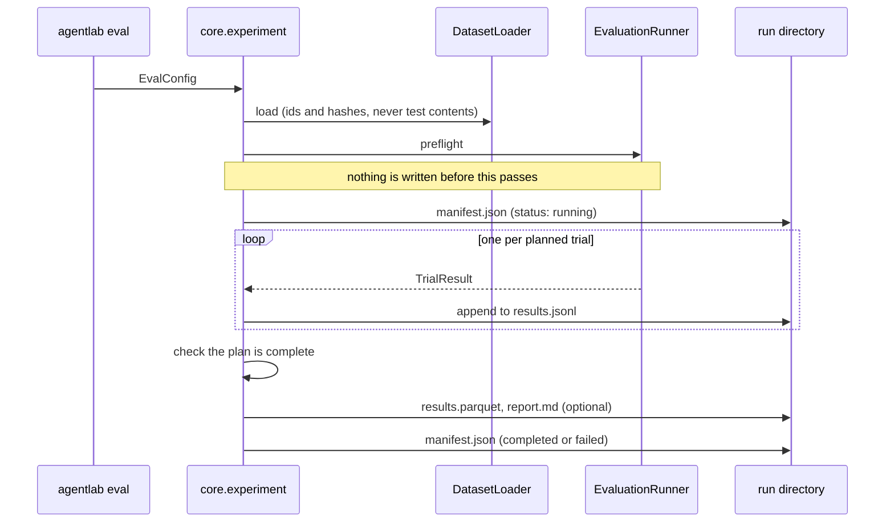

# Architecture

Status words: **Verified** (we ran it), **Planned**, **Unverified** (read upstream, not run).

## Modules and dependency direction

`core.config`, `core.results` and `errors` are the base layer and import nothing above it. Plugins depend on those schemas and on
their own `base.py`; they do not import each other's implementations. `core.experiment` is the only orchestrator.

| Module | Interface | Implemented (Verified) | Planned |
|---|---|---|---|
| Core | `Registry`, `Manifest`, config models | config, includes, manifest, lifecycle | |
| Harness | `HarnessAdapter.harbor_agent()` | Harbor agent configs: oracle, nop, Pi, OpenCode v1 and v2 | |
| Dataset | `DatasetLoader.load()` -> `LoadedDataset` | local Harbor directories, hashing, audit | Hugging Face and git, v0.1 |
| Inference | `InferenceBackend.probe()` | OpenAI-compatible and vLLM probe | |
| Rollout | `Trajectory`, `Turn` | schema and invariants | OpenEnv capture, v0.2 |
| Training | `TrainingBackend.train()`, `AdapterMerger.merge()` | config validation only | TRL v0.2, joint v0.3, merge v0.4 |
| Evaluation | `EvaluationRunner.preflight()` / `.run()` | mock and Harbor runners, metrics, paired comparison | |
| Reporting | `ResultWriter`, `write_reports()` | JSONL, Parquet, Markdown | |

## Evaluation data flow

`HarborRunner` writes a Harbor `JobConfig` to `<run>/harbor/`, starts Harbor as a subprocess with a minimal environment
and telemetry off, reads each trial's `result.json` as it appears and maps it to `TrialResult`. Harbor keeps its raw
outputs there; they are traces, so review them before sharing. On an error, Ctrl-C or SIGTERM Harbor is interrupted so
that it can remove its containers. Why a subprocess: [ADR 0006](DECISIONS/0006-harbor-subprocess.md).

For training (Planned), OpenEnv's capture proxy sits between agent and vLLM and TRL consumes its `TrainingTrace`. Reused
upstream APIs and their limits: [UPSTREAM.md](UPSTREAM.md).

## Reproducibility

- Revisions are full commit hashes; harness versions are exact; unknown config keys are errors.
- Local datasets are identified by content hash, including hidden tests and file modes.
- A trial seed depends on experiment seed, dataset, task and attempt, not on model or harness.
- `compare` refuses runs whose `Manifest.comparability()` differs (datasets, harnesses, sampling, server flags, seed,
  hardware, packages). Model and adapter are the variable under test. `--allow-mismatch` prints what differed.

## Errors

| Exit code | Class | Meaning |
|---|---|---|
| 2 | `ConfigError` | invalid input; also used by the argument parser |
| 3 | `FeatureNotImplementedError` | planned feature; nothing was written |
| 4 | `RunError` | the run or a run directory is broken |
| 5 | `ComparisonError` | runs are not comparable |
| 6 | `LeakageError` | the audit found overlap |

A failed *trial* is data (`TrialResult.outcome`). A failed *run* raises; the manifest is marked `failed` and finished
trials are kept. Anything else is a bug and keeps its traceback.

## Security boundaries

API keys are referenced by environment variable name only, and endpoint URLs must not carry credentials. `TaskRef` has no
field for tests or solutions. Endpoint URLs are written to manifests: review a manifest before publishing it.

Decisions: [DECISIONS/](DECISIONS/README.md).
