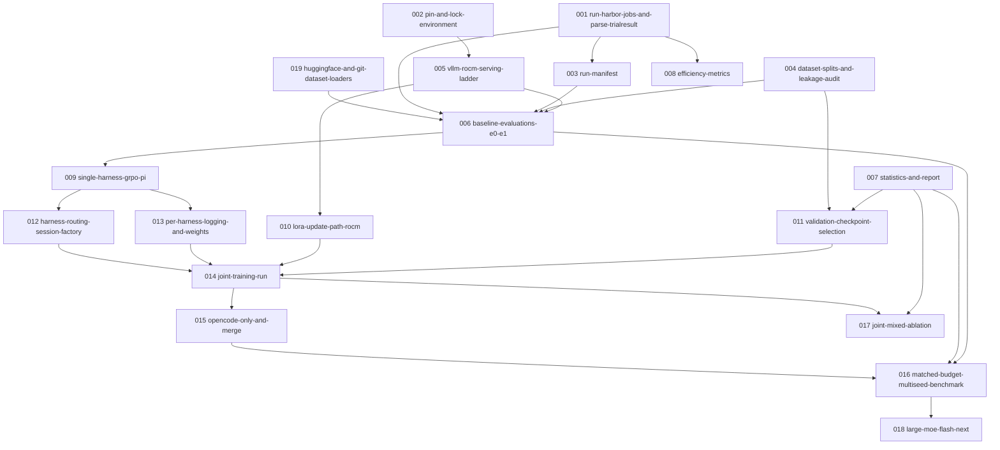

# Issue drafts

Ordered work items. Milestones are described in [../ROADMAP.md](../ROADMAP.md). These are drafts, not filed issues.

| # | Title | Milestone | Depends on |
|---|---|---|---|
| [001](001-run-harbor-jobs-and-parse-trialresult.md) | Run Harbor jobs (Pi and OpenCode) from an experiment config and parse TrialResult into the result schema | v0.1 | none |
| [002](002-pin-and-lock-environment.md) | Pin and lock the serving and training environments | v0.1 | none |
| [003](003-run-manifest.md) | Remaining manifest fields | v0.1 | 001 |
| [004](004-dataset-splits-and-leakage-audit.md) | Dataset splits and leakage audit | v0.1 | none |
| [005](005-vllm-rocm-serving-ladder.md) | Serve the base model with vLLM on ROCm and pass ladder rungs 0-3 | v0.1 | 002 |
| [006](006-baseline-evaluations-e0-e1.md) | Baseline evaluations E0 and E1 | v0.1 | 001, 003, 004, 005, 019 |
| [007](007-statistics-and-report.md) | Bootstrap intervals, Holm correction and k-sample scores | v0.1 | none |
| [008](008-efficiency-metrics.md) | Extract efficiency fields from Harbor and ATIF; GPU-hour pricing | v0.1 | 001 |
| [009](009-single-harness-grpo-pi.md) | Single-harness GRPO under Pi (E2) | v0.2 | 006 |
| [010](010-lora-update-path-rocm.md) | LoRA update path on ROCm | v0.2 | 005 |
| [011](011-validation-checkpoint-selection.md) | Checkpoint selection on validation only | v0.2 | 004, 007 |
| [012](012-harness-routing-session-factory.md) | Harness routing session factory | v0.3 | 009 |
| [013](013-per-harness-logging-and-weights.md) | Per-harness logging and row-weight controls | v0.3 | 009 |
| [014](014-joint-training-run.md) | Joint multi-harness training run (E3) | v0.3 | 012, 013, 010, 011 |
| [015](015-opencode-only-and-merge.md) | OpenCode-only specialist and adapter merge | v0.4 | 014 |
| [016](016-matched-budget-multiseed-benchmark.md) | Matched-budget multi-seed benchmark (E4) | v0.4 | 015, 007, 006 |
| [017](017-joint-mixed-ablation.md) | Joint-mixed group ablation | v0.4 | 014, 007 |
| [018](018-large-moe-flash-next.md) | Qwen3.8-Flash-Next feasibility and reduced benchmark | v0.5 | 016 |
| [019](019-huggingface-and-git-dataset-loaders.md) | Hugging Face and git dataset loaders | v0.1 | none |

